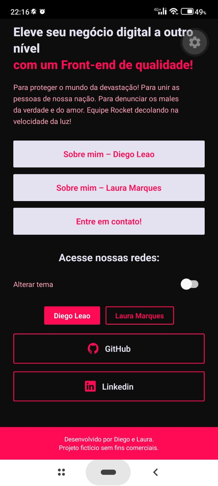

# DEV.SPOT

Projeto Bimestral de **React Native** — Tópicos Especiais.

Aplicativo mobile feito com **Expo + React Native + TypeScript**, com duas telas (**Home** e **Sobre mim**) e navegação entre elas.

---

## 👥 Integrantes

| Nome | GitHub |
|------|--------|
| Diego | [@diegolvf](https://github.com/diegolvf) |
| Laura | [@usuario](https://github.com/usuario) |

> Curso: ADS · Instituição: *Fatec - Itu* · Disciplina: Tópicos Especiais · Professor(a): *Melky Fanti Duenas*

---

## 📱 Descrição do app

O **DEV.SPOT** é um app de apresentação da dupla de desenvolvedores, com visual inspirado em identidade "dev" (fontes Bebas Neue e Orbitron e paleta de cores própria).

O app possui duas telas:

- **Home**: tela inicial com o texto de apresentação do projeto e os botões de navegação.
- **Sobre mim**: tela com informações pessoais de cada integrante, como contato e redes sociais.

Principais pontos técnicos:

- Navegação entre telas com **React Navigation** (Native Stack), com animação `slide_from_right`.
- **Tema** global via `ThemeProvider` / `useTheme` (cores e `StatusBar` se adaptam ao tema).
- Ícones com `@expo/vector-icons`.
- Código em **TypeScript**, organizado em `src/` (telas, tema e tipos de navegação).

### Tecnologias

| Tecnologia | Versão |
|------------|--------|
| Expo | ~57.0 |
| React Native | 0.86 |
| React | 19.2 |
| React Navigation (native + native-stack) | 7.x |
| TypeScript | ~6.0 |

---

## 🖼️ Prints das telas

### Home

| Home | Troca de tema (Home) | Botão "Entre em contato" (Home) |
|:----:|:--------------------:|:-------------------------------:|
|  |  |  |

### Sobre mim

| Perfil Laura | Alerta Laura | Troca de tema (Perfil) |
|:------------:|:------------:|:----------------------:|
|  |  |  |

| Entre em contato Diego | Alerta Diego |
|:----------------------:|:------------:|
|  |  |

---

## 🚀 Como rodar o projeto

### Pré-requisitos

- [Node.js](https://nodejs.org/) (versão LTS) e npm
- [Git](https://git-scm.com/)
- App **Expo Go** instalado no celular (Android / iOS), **ou** um emulador Android/iOS configurado

### Passo a passo

1. **Clone o repositório**

   ```bash
   git clone https://github.com/diegolvf/ProjBimReactNative.git
   cd ProjBimReactNative
   ```

2. **Instale as dependências**

   ```bash
   npm install
   ```

3. **Inicie o projeto**

   ```bash
   npm start
   ```

4. **Abra o app**

   - No celular: escaneie o QR Code exibido no terminal com o **Expo Go** (Android) ou com a câmera (iOS). O celular e o computador devem estar na mesma rede Wi-Fi.
   - No emulador Android: pressione `a` no terminal.
   - No simulador iOS (somente macOS): pressione `i` no terminal.
   - No navegador: pressione `w` no terminal.

### Scripts disponíveis

| Comando | O que faz |
|---------|-----------|
| `npm start` | Inicia o servidor do Expo |
| `npm run android` | Inicia e abre no Android |
| `npm run ios` | Inicia e abre no iOS |
| `npm run web` | Inicia e abre no navegador |

---

## 📁 Estrutura do projeto

```
ProjBimReactNative/
├── assets/            # Imagens e ícones
├── src/
│   ├── screens/       # HomeScreen e AboutScreen
│   ├── theme/         # Tema (LoadTheme)
│   └── types/         # Tipos da navegação
├── App.tsx            # Navegação e provider de tema
├── index.ts           # Ponto de entrada
├── app.json           # Configuração do Expo
└── package.json
```

---

## 📄 Licença

Distribuído sob a licença MIT. Veja o arquivo [LICENSE](LICENSE).
